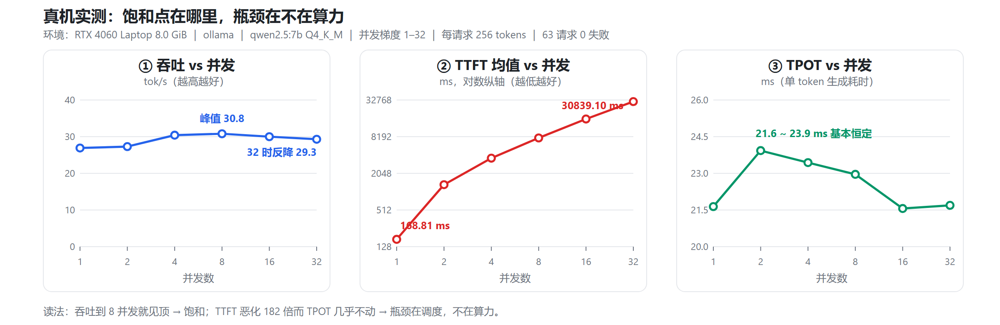

# 大模型私有化交付：显存估算与压测的三个致命陷阱

> 本文作者原创，首发于 CSDN：<https://blog.csdn.net/2302_79954719/article/details/167391644>
> 仓库内另有 CSDN 排版版（本文为掘金规范重排版）：[article-csdn-3-traps.md](article-csdn-3-traps.md)
> 配套开源手册《大模型私有化交付操作手册》：<https://gitee.com/wang-guangshuooo/llm-private-deploy-handbook>

## TL;DR

1. 显存估算必须算 **KV Cache**，否则并发能力估错数倍——而"错多少倍"取决于 GQA 分组比，不是固定的 8 倍。
2. **TTFT 口径**不书面统一，验收现场能吵出十倍差；推理模型的思考段是单独字段，单独统计。
3. 容量规划看**饱和点与尾延迟**，不能只看吞吐均值——测出饱和点才知道该配几路。

---

## 先说什么叫"算错了"

私有化交付大模型，翻车最多的**不是"装不上"，而是"算错了"**。

装不上会报错，当场就能发现。算错了不报错——它安静地给你一个错误的数字，你把它写进方案，客户按它配了机器，验收那天才发现不对。

下面三个陷阱是代价最高的三个，共同点是：**代码不报错，错误要到很晚才暴露。**

| # | 陷阱 | 症状 | 代价 |
| :---: | --- | --- | --- |
| 一 | 显存估算只算权重 | 忽略 KV Cache，容量高估数倍 | 买错卡 / 并发只有预估的 1/5 |
| 二 | TTFT 口径不统一 | 同一个词两个人量出差十倍 | 验收现场扯皮 |
| 三 | 只看吞吐均值 | 漏掉饱和点与尾延迟 | 容量规划拍脑袋 |

---

## 陷阱一：显存估算只算权重，KV Cache 被漏掉

很多人算显存是这样算的：

```text
72B FP16 → 72.7 × 2 = 145.4 GB → 8 张 80G 卡够，收工。
```

问题在于显存是**三项之和**：

```text
总显存需求 = 权重显存 + KV Cache 显存 + 激活/框架开销
```

权重只是"装得下"的门槛，**KV Cache 才是决定"能服务多少并发"的那一项**。而并发能力才是客户真正要买的东西。

### 1.1 权重显存：一行乘法，但别用约数

| 精度 | 每参数字节 | 说明 |
| --- | ---: | --- |
| FP16 / BF16 | 2.0 | 推理默认 |
| FP8 | 1.0 | 需 H100/L40S 等支持 |
| INT8 (W8A8) | 1.0 + 少量 scale | 精度损失小 |
| INT4 (AWQ/GPTQ) | ≈0.55 | 含 scale/zero point，实际约 0.5~0.6 |

| 模型 | FP16 | INT8 | INT4 |
| --- | ---: | ---: | ---: |
| 7B（7.6B） | 15.2 | 7.6 | 4.2 |
| 14B（14.7B） | 29.4 | 14.7 | 8.1 |
| 32B（32.5B） | 65.0 | 32.5 | 17.9 |
| 72B（72.7B） | **145.4** | 72.7 | 40.0 |

（单位 GB。用**真实参数量** 7.6B / 72.7B，别用"7B / 72B"这种约数。）

### 1.2 KV Cache：最容易被漏掉的一项

```text
单 token KV 字节 = 2 × 层数 × KV 头数 × head_dim × 每元素字节
```

`2` 是 Key 和 Value 各一份。各模型单 token KV 占用（FP16）：

| 模型 | 层数 | KV 头数 | head_dim | 单 token | 8K 上下文 |
| --- | ---: | ---: | ---: | ---: | ---: |
| Qwen2.5-7B | 28 | 4 | 128 | 56 KiB | 448 MiB |
| Qwen2.5-14B | 48 | 8 | 128 | 192 KiB | 1.5 GiB |
| Qwen2.5-32B | 64 | 8 | 128 | 256 KiB | 2.0 GiB |
| Qwen2.5-72B | 80 | 8 | 128 | **320 KiB** | 2.5 GiB |

**这里就是那个坑：GQA 的分组比。**

Qwen2.5-72B 有 **64 个注意力头**，但只有 **8 个 KV 头**（分组查询注意力，8:1）：

```text
2 × 80 层 × 64 头 × 128 × 2 字节 = 2.5 MiB / token   ← 错，是实际值的 8 倍
2 × 80 层 ×  8 头 × 128 × 2 字节 = 320 KiB / token   ← 对
```

**一个字段看错，单 token KV 就错 8 倍**，并发能力估算跟着错 8 倍。

> 注意别把"8 倍"当成口诀背下来——**分组比因模型而异**。我从 ModelScope 上各模型的官方 `config.json` 实读的字段如下：

| 模型 | `num_attention_heads` | `num_key_value_heads` | 分组比 | 按注意力头误算会差 |
| --- | ---: | ---: | :---: | :---: |
| Qwen2.5-7B | 28 | 4 | 7:1 | 7 倍 |
| Qwen2.5-14B | 40 | 8 | 5:1 | 5 倍 |
| Qwen2.5-32B | 40 | 8 | 5:1 | 5 倍 |
| Qwen2.5-72B | 64 | 8 | 8:1 | 8 倍 |

四个模型三个不同的倍数。**所以唯一可靠的做法是打开 `config.json` 读 `num_key_value_heads`**——这个字段名和 `num_attention_heads` 长得很像，但它们不是一回事。

### 1.3 写个 20 行的脚本，把并发算出来

手工算容易漏项，我把它写成了一个不依赖任何第三方库的脚本（放在手册仓库 `scripts/estimate_kv.py`）：

```bash
python scripts/estimate_kv.py --config <模型目录>/config.json \
    --params-b 72.7 --gpu-gb 80 --gpus 8 --overhead-gb 32 --ctx 32768
```

对 Qwen2.5-72B-Instruct 的真实 `config.json` 跑出来的结果：

```text
层数            : 80
注意力头 / KV 头 : 64 / 8  （GQA 分组 ≈ 8:1）
head_dim        : 128
单 token KV     : 320 KiB
  ⚠️ 若误按注意力头数(64)算 = 2.5 MiB，是实际值的 8.0 倍
单序列 32768 上下文: 10 GiB

--- 显存拆分 ---
权重            : 145.4 GB  (72.7B × 2.0)
可用显存        : 576.0 GB  (640 × 0.9)
减激活/框架开销  : 32.0 GB
KV Cache 池     : 398.6 GB
单序列占用      : 10 GiB
≈ 可支持并发     : 39 路  (理论 39.86)
```

脚本会**主动提示**你"按注意力头算会差几倍"，这个提醒比结果本身更有用——它专门用来拦上面那个坑。

顺带一个实现细节：`head_dim` 在很多模型的 `config.json` 里并不显式给出，需要用 `hidden_size / num_attention_heads` 推出来（Qwen2.5 全系都是 8192/64 = 128）。**这也是一个容易踩空的地方——字段缺失时不要默认 128 硬编。**

> ⚠️ 并发路数一律**向下取整**（39.86 → 39）。容量规划宁可报少不能报多，报多了就是验收现场打脸。

### 1.4 三个完整算例

**算例 1：Qwen2.5-7B FP16，单卡 A100 40G，8K 上下文**

| 项 | 计算 | 结果 |
| --- | --- | ---: |
| 权重 | 7.6B × 2 | 15.2 GB |
| 可用显存 | 40 GB × 0.90（`gpu_memory_utilization`） | 36.0 GB |
| 减激活/框架 | 取 1.5 GB | 34.5 GB |
| **KV Cache 池** | 36.0 − 15.2 − 1.5 | **19.3 GB** |
| 单序列 8K 占用 | 56 KiB × 8192 | 448 MiB |
| **可支持并发** | 19.3 × 1024 / 448 | **≈ 44 路** |

**算例 2：Qwen2.5-72B FP16，8 × A100 80G，32K 上下文**

| 项 | 计算 | 结果 |
| --- | --- | ---: |
| 权重 | 72.7B × 2 | 145.4 GB |
| 可用显存 | 640 GB × 0.90 | 576 GB |
| 减激活/框架/通信 | 4 GB × 8 | 32 GB |
| **KV Cache 池** | 576 − 145.4 − 32 | **398.6 GB** |
| 单序列 32K 占用 | 320 KiB × 32768 | 10 GiB |
| **可支持并发** | 398.6 / 10 | **≈ 39 路** |

**8 张 80G 卡，只能同时服务约 39 路 32K 上下文的请求。** 这个数字往往低于客户预期——很多方案只报"能跑起来"，但并发能力被 KV Cache 死死限制住。

**算例 3：Qwen2.5-72B AWQ INT4，8 × A100 40G，8K 上下文**

| 项 | 计算 | 结果 |
| --- | --- | ---: |
| 权重 | 72.7B × 0.55 | 40.0 GB |
| 可用显存 | 320 GB × 0.90 | 288 GB |
| 减激活/框架 | 3 GB × 8 | 24 GB |
| **KV Cache 池** | 288 − 40 − 24 | **224 GB** |
| 单序列 8K 占用 | 320 KiB × 8192 | 2.5 GiB |
| **可支持并发** | 224 / 2.5 | **≈ 89 路** |

量化把并发从"约 39 路（32K）"提到"约 89 路（8K）"，代价是权重从 145 GB 降到 40 GB，并接受量化精度损失。**这就是"精度 vs 容量"的量化决策依据。**

### 1.5 上线后一定要反向校验

估完不算完，跑起来要核对：

```bash
# vLLM 启动日志里会打印：
#   "GPU KV cache size: XXX tokens"
#   "Maximum concurrency for XXX tokens per request: Y.Yx"

# 实时看显存
nvidia-smi --query-gpu=index,memory.used,memory.total,utilization.gpu \
           --format=csv -l 5

# 从 Prometheus 指标看 KV Cache 使用率
curl -s localhost:8000/metrics | grep gpu_cache_usage_perc
```

**一条实用判据**：正常负载下 `gpu_cache_usage_perc` 应在 **20% ~ 70%** 之间。

- 长期 > 90% → 并发接近上限，请求开始排队，TTFT 会陡增
- 长期 < 10% → 显存浪费，可以调大 `--max-num-seqs` 或减少卡数

---

## 陷阱二：TTFT 这个词，两个人能量出十倍差

`TTFT`（Time To First Token）是交付现场唯一有意义的体感指标——用户不关心"整个回答花了几秒"，他只在意"多久开始出字"。

但这个词**谁都在用，定义却不一样**。同一个服务、同一次压测，两个人给出的 TTFT 可以差十倍。**交付现场 90% 的"性能争议"，本质是双方对 TTFT 的定义不一样。**

### 2.1 从哪一刻开始算？

| 口径 | 含义 | 什么时候用 |
| --- | --- | --- |
| **从发送请求算** | 含 HTTP 建连 + TLS 握手 + 排队 + 预填充 | ✅ **推荐**，最接近用户真实感受 |
| 从收到 HTTP 200 算 | 不含建连，含排队 + 预填充 | 排除网络噪声，对比引擎性能 |
| 从预填充开始算 | 只含预填充计算 | 纯引擎能力对比，**不是用户体验** |

交付压测用第一种，但**必须在报告里写明是哪一种**，并注明"客户端与服务端同机 / 同机房"，否则网络 RTT 会被算进去。

流式请求里最常见的写法就是错的：

```python
resp = client.chat.completions.create(..., stream=True)
ttft = time.perf_counter() - start     # 错：这是 HTTP 200 的时刻
for chunk in resp:                     # 真正的首 token 在这里才到
    ...
```

**HTTP 200 返回的时候，模型一个字都还没出。**

### 2.2 排队时间算不算？

**必须算。** 用户按下回车就开始等了，服务在排队，这段时间他是真实感受到了的。

> 这正是"并发一高 TTFT 就爆炸"的原因——**不是模型变慢了，而是请求在队列里等**。这恰恰是压测最重要的发现之一，把它排除掉等于把最关键的结论藏起来。

### 2.3 推理模型的"思考段"算不算？（最隐蔽）

像 DeepSeek-R1、QwQ 这类推理模型，会先输出一大段思考内容。在 OpenAI 兼容的 SSE 流式接口里，这段内容往往走**不同的字段**（如 `delta.reasoning_content`），而不是 `delta.content`。

实测逐帧解析的结果：

```text
帧 1   ~ 帧 128 : delta 里只有 reasoning_content（思考段）
帧 129          : 第一个 delta.content 出现   ← 真正的 TTFT 应该在这里
帧 129 ~ 帧 211 : 正常输出内容
```

- 把**第一个任意分片**当 TTFT → 第 1 帧就"出字"了，TTFT 被严重低估
- 把 **`reasoning` 也算作输出 token** → TPOT 被摊薄，虚低
- 取 `content` → TTFT 里包含了几十秒思考，数字大得没法跟普通模型对比

三条路都不对，因为**这个指标对推理模型本身就不成立**。

正确做法：

1. TTFT 定义为**第一个 `content` 字段**出现的时刻，思考段单独统计为"思考耗时"，或一并计入端到端但**明确标注**；
2. 报告里必须写清目标模型是**推理模型还是普通模型**；
3. **做配置对比时不要混用推理模型和普通模型**，指标不可比。

**结论：推理模型不适合作为 TTFT 口径对比的基准模型。** 压测前先解析一次 SSE 帧结构，确认字段名。

---

## 陷阱三：只看吞吐均值，不看饱和点和尾延迟

压测做完报一个"吞吐 XXX tok/s"，这几乎等于没报——因为**单看吞吐，你无法回答客户唯一关心的问题：我能服务多少人？**

### 3.1 先看一组真机数据



> **环境标注（很重要）**：RTX 4060 Laptop **8.0 GiB** ｜ Windows 11 ｜ **ollama** ｜ `qwen2.5:7b` Q4_K_M ｜ 并发 1/2/4/8/16/32 ｜ 每请求 256 tokens ｜ 预热 2 次 ｜ 温度 0 ｜ 流式 ｜ 63 个请求、0 失败、总耗时 222.9 s。

| 并发 | 吞吐 (tok/s) | 加速比 | TTFT 均值 (ms) | TTFT P99 (ms) | TPOT (ms) | 端到端 P99 (ms) |
| ---: | ---: | ---: | ---: | ---: | ---: | ---: |
| 1 | 26.9 | 1.00× | 168.81 | 168.81 | 21.64 | 2159.52 |
| 2 | 27.3 | 1.02× | 1335.32 | 2436.17 | 23.93 | 4607.57 |
| 4 | 30.4 | 1.13× | 3636.49 | 6869.47 | 23.44 | 8871.39 |
| **8** | **30.8** | **1.14×** | 7804.78 | 15156.92 | 22.96 | 17178.87 |
| 16 | 30.0 | 1.11× | 15979.12 | 30537.79 | 21.56 | 32414.35 |
| 32 | 29.3 | 1.09× | 30839.10 | 60821.14 | 21.69 | 62798.84 |

显存峰值 5.6 GiB / 8.0 GiB（70.3%），平均 GPU 利用率 71.9%，63 个请求零失败。

### 3.2 这张表能读出三条结论

**结论 1：并发 2 就已经饱和。** 并发 1→2 吞吐只涨 1.5%（26.9 → 27.3），之后最高加速比只有 1.14×。该引擎在单卡消费级 GPU 上的**并发扩展能力极弱**。

**结论 2：饱和后继续加压，只推高延迟、不涨吞吐。** 并发 32 时吞吐不升反降（30.8 → 29.3 tok/s），TTFT 从 168.81 ms 涨到 30839.10 ms——**恶化 182 倍**。

**结论 3：TPOT 几乎不随并发变化（21.6 ~ 23.9 ms）。** 单 token 生成速度基本恒定，而等待时间爆炸式增长。这是典型的 **"TTFT 涨 + TPOT 平" = 调度受限**。

**说明瓶颈不在算力，而在请求调度/排队。可执行的调优方向是换调度更好的引擎（如 vLLM 的 PagedAttention 调度）或增加副本，而不是升级 GPU。**

### 3.3 曲线判读口诀

| 现象 | 含义 | 该怎么调 |
| --- | --- | --- |
| 吞吐线性上升，未到平台 | 资源还没用满 | 可以继续加并发 |
| 吞吐平台 + TTFT 陡增 | **排队饱和**（最典型） | 加副本 / 提 KV 池 |
| 吞吐反降 | 排队开销或显存压力过大 | 停机排查，不要再加压 |
| TTFT 平 + TPOT 涨 | **计算受限** | 提算力（更好的卡 / 更小模型 / 更强量化） |
| TTFT 涨 + TPOT 平 | **调度受限** | 加副本或优化调度，**加算力无用** |
| P99 远大于 P50（> 5 倍） | 存在长尾阻塞 | 开 chunked prefill；排查超长请求 |
| 失败率 > 0 | 先解决错误再谈性能 | 看日志定位 |

> ✅ **"TTFT 涨 + TPOT 平"这个组合最能说明问题**：每个 token 的生成速度没变（算力没变紧），但等待时间在涨（请求在排队）。
> **很多人看到延迟涨就想着换更好的卡，其实是白花钱。**

### 3.4 比吞吐更该看的指标：Goodput

**Goodput = 在 SLO 内完成的请求数 / 时间**

如果 SLO 定义为"TTFT ≤ 2s 且 TPOT ≤ 50ms"，那么上面那张表里，并发 32 时虽然系统吞吐还有 29.3 tok/s，但**几乎没有请求能在 SLO 内完成，Goodput 接近 0**。

**"能跑出多少 token"和"在可接受的延迟内跑出多少 token"是两回事。** 容量规划应该看 Goodput。

### 3.5 引用边界：这组数据不能这么用

这组数字很有说服力，但它有明确的适用边界：

| 能说明 | 不能说明 |
| --- | --- |
| ✅ 该引擎在该硬件上的并发扩展特性 | ❌ 任何数据中心级 GPU 的性能 |
| ✅ "饱和点 + 延迟恶化"这一**现象与判读方法** | ❌ vLLM / TensorRT-LLM 的表现 |
| ✅ 消费级单卡在并发场景下的能力上限 | ❌ 7B 以上模型的性能 |
| ✅ 压测链路（口径、统计、报告）的正确性 | ❌ 生产环境的绝对数值 |

> ⚠️ **引用红线**：这是 **ollama**（调度为单用户设计）而不是 vLLM；这是**笔记本 GPU**（8 GB、功耗受限）而不是数据中心卡；这是 **7B Q4 量化**而不是 72B FP16。
>
> 把这组数字写成"我们在 8 卡 A100 上实测 vLLM 性能 XXX"，就是造假。正确的引用方式是描述**方法与结论**："通过并发梯度压测定位吞吐饱和点，并区分调度瓶颈与算力瓶颈，给出容量配置建议。"

---

## 交付前过一遍：九项自查

| 陷阱 | 自查项 |
| --- | --- |
| **显存** | ① 显存三项都算了吗（权重 + KV + 激活/框架）？<br>② `config.json` 里的 `num_key_value_heads` 看过了吗（GQA 分组）？<br>③ 方案里写了**可支持并发路数**，而不只是"能跑起来"？ |
| **口径** | ④ TTFT 起点与终点和客户**书面**统一了吗？<br>⑤ 排队时间算进去了吗？<br>⑥ 目标模型是不是推理模型？SSE 字段结构确认过了吗？ |
| **结论** | ⑦ 测到**饱和点**了吗？还是只测了单一并发？<br>⑧ 报的是 P95/P99，还是只有均值？<br>⑨ 报告里标注**数据适用边界**了吗？ |

第 ⑨ 项最容易被忽略，也最能体现专业度：**一份主动写清"这组数据不能说明什么"的报告，比一份数字漂亮的报告更让人信得过。**

---

## 参考资料

| 资料 | 与本文的关系 |
| --- | --- |
| [vLLM 官方文档](https://docs.vllm.ai/en/latest/) | 1.3 节算例里的 `gpu_memory_utilization` 与 KV Cache 池口径，以它的官方定义为准 |
| [GQA 原论文（arXiv:2305.13245）](https://arxiv.org/abs/2305.13245) | 1.2 节"KV 头数 ≠ 注意力头数"的原理出处，分组比怎么来的看这篇 |
| [Qwen2.5-72B-Instruct 模型页（ModelScope）](https://modelscope.cn/models/Qwen/Qwen2.5-72B-Instruct) | 1.2/1.3 节的 `config.json` 字段值，可直接下载核对 |
| [DeepSeek-R1 官方仓库](https://github.com/deepseek-ai/DeepSeek-R1) | 2.3 节推理模型思考段与 `content` 字段的区分 |
| [ollama 官方 FAQ](https://docs.ollama.com/faq) | 3.1 节真机压测用的是 ollama，并发与上下文相关的调优问题看这里 |
| [OpenAI Chat Completions API（流式）](https://platform.openai.com/docs/api-reference/chat) | 2.1 / 2.3 节依赖对 SSE 流式帧结构的准确理解 |

---

## 项目地址

**<https://gitee.com/wang-guangshuooo/llm-private-deploy-handbook>**

一份从环境勘察到验收移交的全流程操作手册：8 章正文 + 3 篇附录 + 3 张交付模板，覆盖 vLLM / SGLang / TGI / TensorRT-LLM / lmdeploy / ollama；本文用到的 `scripts/estimate_kv.py` 也在仓库里，可 `--selftest` 自检。

| 章节 | 内容 |
| --- | --- |
| 01 交付总览 | 8 阶段交付模型、角色职责矩阵、交付物清单、准出条件 |
| 02 环境勘察与准入检查 | GPU/CPU/网络/存储勘察命令、版本对应表、信创要点 |
| 03 部署方案设计 | **显存估算公式与算例**、模型选型、量化、TP/PP/DP/EP 决策树 |
| 04 实施部署 | 驱动与 CUDA、模型完整性校验、启动参数逐项详解、健康检查 |
| 05 压测与性能调优 | **TTFT/TPOT 口径定义**、压测设计、调优矩阵、曲线判读、真实案例 |
| 06 验收 | 功能/性能/稳定性验收标准怎么写、不通过怎么办 |
| 07 运维与故障排查 | 巡检制度、告警阈值、**6 棵故障树**、应急预案 |
| 08 交付物与模板 | 全部交付物的用途与填写要点 |
| 附录 A/B/C | 命令速查、四张可打印检查清单、术语表 |

文档正文 CC BY 4.0，代码片段 MIT，**欢迎转载与二次整理，注明出处即可**。发现参数默认值或命令语法与实际版本不符，欢迎提 Issue——**这份手册的价值在于持续被现实修正。**

---

## 发布信息（掘金表单用，不要贴进正文）

**标题**（15~35 字最佳）：

- `大模型私有化交付：显存估算与压测的三个致命陷阱`（23 字）
- `8 张 A100 只能服务 39 路请求？聊聊大模型交付里的显存估算`（34 字）
- `显存、TTFT、饱和点：大模型私有化交付最容易算错的三件事`（29 字）

**分类**（必选 1 个）：`后端`　（备选 `人工智能`——流量更大，但内容偏部署运维，`后端` 更准）

**标签**（1~5 个，按顺序填）：

1. `大模型`（宽泛，覆盖人群）
2. `vLLM`（具体技术栈，掘金上热度高）
3. `性能优化`（宽泛，流量词）
4. `私有化部署`（精准，与标题呼应）
5. `显存优化`（精准长尾，竞争小）

**摘要**（掘金上限 150 字；会出现在**推荐流与分享卡片**，不填则取正文前 N 字）

**A · 推荐（110 字）**

> 私有化交付大模型，翻车最多的不是"装不上"而是"算错了"——算错不报错。三个代价最高的陷阱：显存只算权重、漏算 KV Cache（GQA 分组比并非固定 8 倍）；TTFT 口径不统一；只看吞吐均值、漏掉饱和点与尾延迟。

**B · 短版（76 字，适合信息流卡片）**

> 显存少算 KV Cache、TTFT 口径各说各话、只看吞吐不看饱和点——大模型私有化交付最容易算错的三件事。附显存估算算例与一组可复现的真机压测数据。

**C · 数字开头（95 字，靠数字抓人）**

> 8 张 A100 80G 只能同时服务约 39 路 32K 上下文的请求？私有化交付里最贵的错误都藏在数字里：显存只算权重漏掉 KV Cache、TTFT 口径各说各话、只报吞吐不报饱和点。

> 三版都刻意避开"深度解析 / 全面指南 / 一文读懂"这类零信息词，并把搜索词（显存估算、KV Cache、TTFT、饱和点）放进第一句之后。**别留空**——系统抓正文前 N 字，很可能抓到一段代码块。

**CSDN 版（233 字，上限 256）**

> 私有化交付大模型，翻车最多的不是"装不上"而是"算错了"——因为算错不报错。本文拆三个代价最高的陷阱：① 显存只算权重，漏掉 KV Cache（含 GQA 分组比陷阱：Qwen2.5 四个模型分别是 7:1 / 5:1 / 5:1 / 8:1，不是固定 8 倍，附三个完整算例）；② TTFT 口径不统一，同一个词能量出十倍差（含推理模型 reasoning_content 陷阱）；③ 只看吞吐均值，漏掉饱和点与尾延迟（附一组可复现的真机压测数据与曲线判读口诀）。

**文章类型**：`原创`（本文为你本人原创，已在文首标注首发平台；若担心查重判定，也可选 `转载` 并填入 CSDN 原文链接）

**配图**：正文里的 `images/private-deploy-3-traps-curves.png` 是仓库相对路径，**掘金读不到——需要手动上传** `docs/images/private-deploy-3-traps-curves.png` 后，把那一行替换成编辑器插入的图片。
